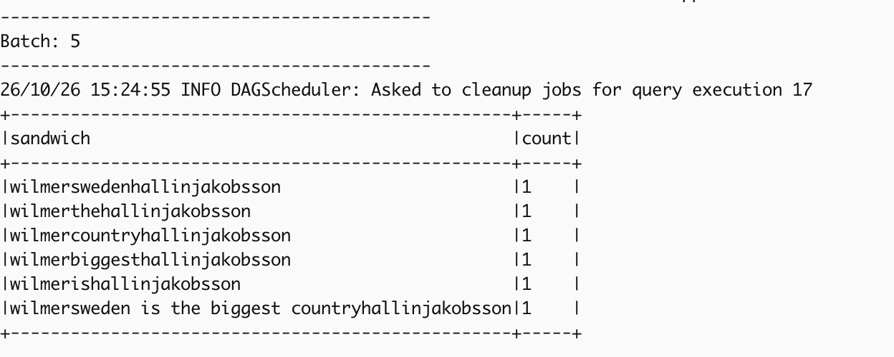
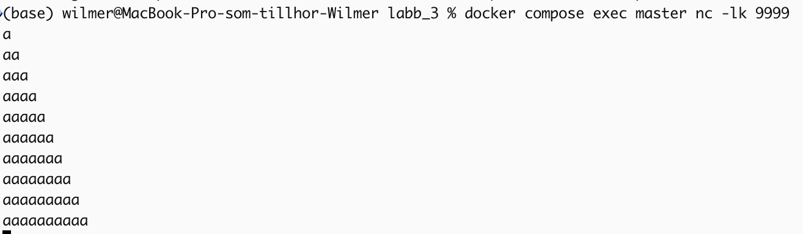
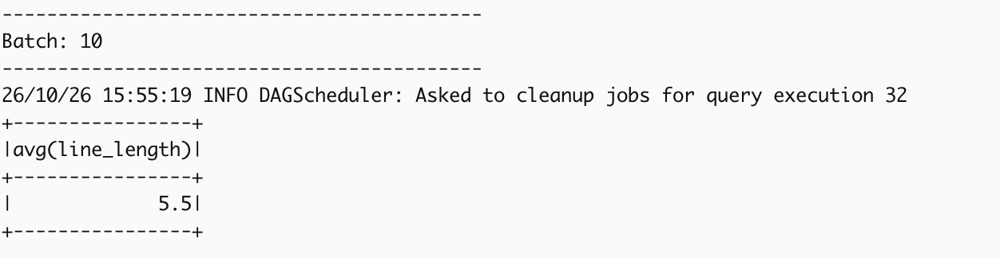
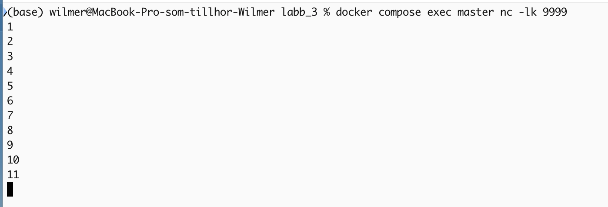
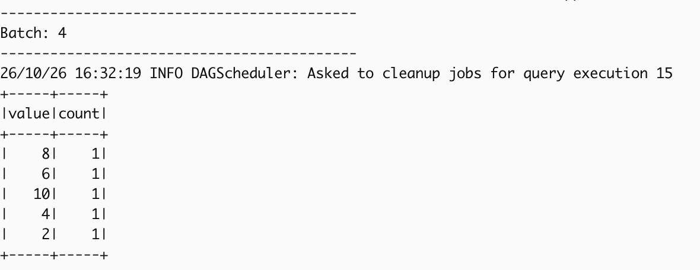
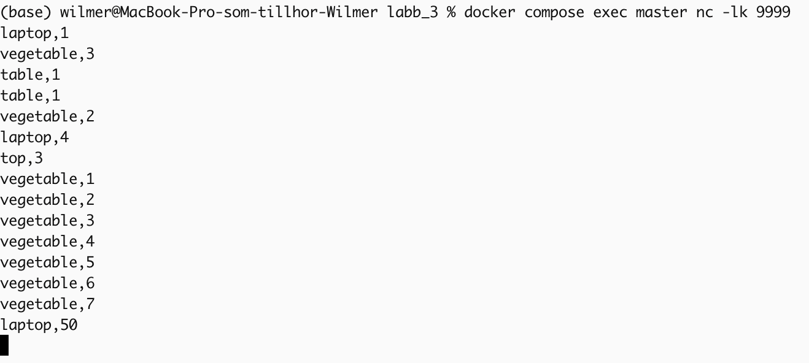
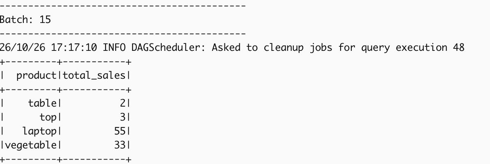

# Lab 3

Use docker compose to create an image and a compose of a worker and a master and a network.
```
docker compose up -d --build
```

Start a netcat listener to port 9999.
```
docker compose exec master nc -lk 9999
```

Submit the job to the master.
```
docker compose exec master /opt/spark/bin/spark-submit --master spark://master:7077 /opt/spark/work-dir/task_x.py
```


## Task 1

### Screenshots


### Code
```(python)
from pyspark.sql import SparkSession
from pyspark.sql.functions import udf
from pyspark.sql.types import StringType

spark = SparkSession.builder \
    .appName("SimpleStructuredStreaming") \
    .getOrCreate()
    
def name_sandwich(string):
    return "wilmer" + string + "hallinjakobsson"

# register udf
sandwich_udf = udf(name_sandwich, StringType())
    
inputStream = spark.readStream \
    .format("socket") \
    .option("host", "localhost") \
    .option("port", 9999) \
    .load()

# Use the UDF
sandwichStream = inputStream.select(sandwich_udf(inputStream.value).alias("sandwich"))
sandwiches = sandwichStream.groupBy("sandwich").count()

query = sandwiches\
    .writeStream \
    .outputMode("complete") \
    .format("console") \
    .option("truncate", "false") \
    .start()

query.awaitTermination()
```

## Task 2

### Screenshots



### Code
```(python)
from pyspark.sql import SparkSession


spark = SparkSession.builder \
    .appName("SimpleStructuredStreaming") \
    .getOrCreate()

    
inputStream = spark.readStream \
    .format("socket") \
    .option("host", "localhost") \
    .option("port", 9999) \
    .load()

lineLengths = inputStream.selectExpr("length(value) as line_length")
avgLength = lineLengths.selectExpr("avg(line_length)")

query = avgLength \
    .writeStream \
    .outputMode("complete") \
    .format("console") \
    .start()

query.awaitTermination()
```

## Task 3

### Screenshots



### Code
```(python)
from pyspark.sql import SparkSession


spark = SparkSession.builder \
    .appName("SimpleStructuredStreaming") \
    .getOrCreate()

    
inputStream = spark.readStream \
    .format("socket") \
    .option("host", "localhost") \
    .option("port", 9999) \
    .load()

inputStream.createOrReplaceTempView("numbers")

evenNumberFilterStream = spark.sql("SELECT value FROM numbers WHERE CAST(value AS INT) % 2 = 0")

evenCounts = evenNumberFilterStream.groupBy("value").count()


query = evenCounts \
    .writeStream \
    .outputMode("complete") \
    .format("console") \
    .start()

query.awaitTermination()
```


## Task 4

### Screenshots



### Code
```(python)
from pyspark.sql import SparkSession
from pyspark.sql.functions import explode, split


spark = SparkSession.builder \
    .appName("SimpleStructuredStreaming") \
    .getOrCreate()
    
streamingInputDF = spark.readStream \
    .format("socket") \
    .option("host", "localhost") \
    .option("port", 9999) \
    .load()

splitDF = streamingInputDF.selectExpr("split(value, ',')[0] as product", "split(value, ',')[1] as quantity")
splitDF.createOrReplaceTempView("product_sales")
salesPerProduct = spark.sql("SELECT product, SUM(CAST(quantity AS INT)) as total_sales FROM product_sales GROUP BY product")

query = salesPerProduct \
    .writeStream \
    .outputMode("complete") \
    .format("console") \
    .start()

query.awaitTermination()
```

## Dockerfile and compose.yaml
Dockerfile.
```
FROM apache/spark:python3

USER root
RUN apt-get update \
 && apt-get install -y --no-install-recommends netcat-openbsd \
 && rm -rf /var/lib/apt/lists/* 
USER spark

WORKDIR /opt/spark/work-dir
```
compose.yaml
```
services:
  master:
    image: spark-lab
    build: .
    hostname: master
    environment:
      - SPARK_MASTER_HOST=master
    command: /opt/spark/bin/spark-class org.apache.spark.deploy.master.Master
    ports:
      - "8080:8080"
      - "7077:7077"
    volumes:
      - ./app:/opt/spark/work-dir

  worker:
    image: spark-lab
    depends_on:
      - master
    environment:
      - SPARK_WORKER_CORES=2
      - SPARK_WORKER_MEMORY=1g
    command: /opt/spark/bin/spark-class org.apache.spark.deploy.worker.Worker spark://master:7077
    volumes:
      - ./app:/opt/spark/work-dir
```
